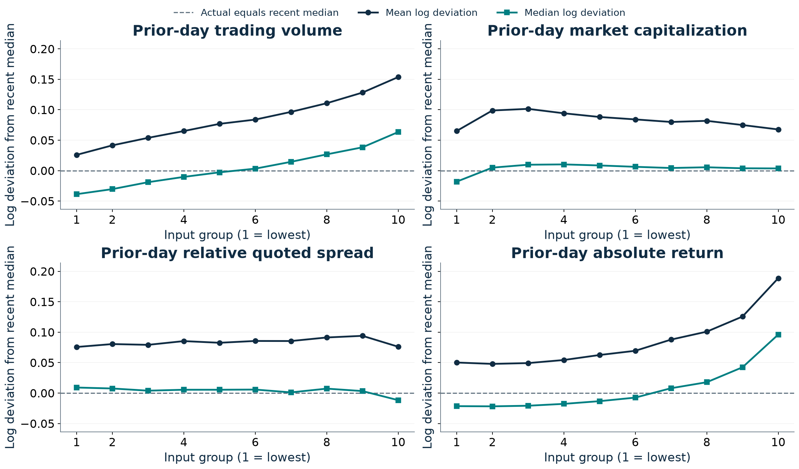

# Covariates and deviations from the recent auction median

This supporting diagnostic uses the saved 2022–2024 development forecast universe. Of 963,525 stock-days, 616 lack a stock-specific trailing median and are excluded here. The main baseline-versus-ridge evaluation retains those cases with the saved historical fallback. Each input uses its own complete pairs, so its sample count can be smaller.

The outcome is `r = log(1 + actual auction shares) − log(1 + prior-only 20-observation auction median)`. Zero means equality to the recent median; positive/negative values mean above/below it. This is the model’s existing target formulation before fallback and forecast clipping. It is neither a fitted-model error nor a causal estimate.

| Prior-close input | Pairs | Rank correlation with auction shares | Rank correlation with log deviation |
| --- | ---: | ---: | ---: |
| Prior-day trading volume | 962,909 | 0.857 | 0.075 |
| Prior-day market capitalization | 962,909 | 0.634 | 0.012 |
| Prior-day relative quoted spread | 962,802 | -0.448 | -0.015 |
| Prior-day absolute return | 962,850 | -0.053 | 0.067 |

## What the comparisons show

- Prior-day market capitalization has a strong raw-volume rank association (0.634), but little association with the log deviation (0.012). Its adjusted curve is also much flatter than the raw-share curve. This is consistent with a substantial scale component in this sample, without identifying a causal mechanism.
- Prior-day trading volume retains a modest increasing relationship with the adjusted outcome: rank correlation 0.075, compared with 0.857 for raw shares. A strong level relationship does not translate into the same strength for departures from the baseline.
- The spread association also becomes weak on the adjusted outcome (−0.015). Absolute returns have a modest positive adjusted association (0.067), while their raw-share rank association is −0.053. This motivates testing the outcome relevant to the model without establishing incremental forecast gains.

## Interpretation limits

- These plots examine departures from the stock-specific baseline, supplementing the existing natural-unit target plots.
- Removing a recent median does not control for calendar, stock, or market confounders. Differences across stocks and dates remain.
- Inputs are correlated with each other and with the historical baseline. The curves do not estimate partial effects or incremental out-of-time predictive value.
- Rank correlations with raw shares and log deviations use the same complete pairs. This makes the scale-versus-departure comparison consistent.
- Log deviations are not share-volume percentage errors. Exponentiating an average log deviation does not yield an arithmetic mean volume ratio.
- This is a retrospective diagnostic of development years already used in research. No new validation period, calibration correction, feature selection, or model fit is introduced.

## Reproduction

Run `build_baseline_adjusted_analysis.py` with pandas, NumPy, Matplotlib, and DuckDB. It reads the existing isolated `cache/analysis_panel.parquet` and saved global-forecast keys. If the cache is unavailable, rebuild it with `build_panels.py`. All outputs stay within the presentation folder.
