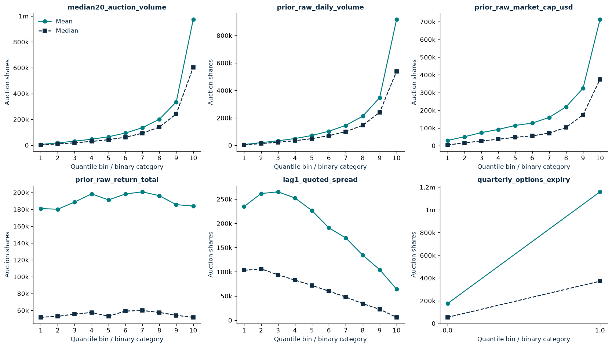

# Natural-unit covariate findings

## What was added

The new study covers **193 specifications**: all 99 engineered daily features, 31 economic source covariates measured contemporaneously and 31 prior-close counterparts, two closing-outcome diagnostics, and six intraday variables at each of five checkpoints. All 58 selected model features have individual results. Calendar and industry covariates are covered in the daily feature set. Identifiers, duplicated source representations, symbol-link metadata, and quality flags are not treated as economic predictors.

The primary target is always **official closing-auction volume in shares**. Every binned curve reports its mean and median in shares, without a log transformation. The old relationship work was useful but incomplete for this purpose: continuous relationships largely used a transformed target, while some binary and categorical summaries already reported raw medians.

## The main empirical distinctions

1. **Auction history is the strongest ordering signal.** The lagged 20-auction median has raw Pearson correlation about 0.521 and sampled Spearman correlation about 0.920 with the raw target. Its within-stock raw-share Pearson correlation is about 0.222. The rank relationship is much stronger than the raw linear relationship because extreme auction spikes contribute heavily to raw-share variation. A strong pooled relationship is not the same as a uniformly accurate forecast.
2. **Trading liquidity is informative, but same-day volume is not a permissible daily input.** Current daily volume has raw Pearson correlation about 0.527. The prior-close counterpart is about 0.393, with rank correlation about 0.830 and within-stock raw correlation about 0.138. Current-day total volume includes the auction itself. Its stronger contemporaneous association therefore includes mechanical overlap and unavailable closing information.
3. **Market cap describes stock scale more strongly than deviations within a stock.** Prior market cap has raw pooled Pearson correlation about 0.289 and rank correlation about 0.654, but within-stock raw Pearson correlation of only about 0.022. This is compatible with omitting a separate size family when auction and liquidity history already encode scale. It does not mean size is economically irrelevant.
4. **Signed prior returns do not show a strong monotone relationship.** Their raw Pearson correlation is about 0.001 and sampled rank correlation about 0.006. Annual raw correlations are positive in six years and negative in five. The raw-share bin curve is non-monotone. This does not rule out information in absolute returns, volatility, or interactions; absolute returns already enter a retained illiquidity proxy.
5. **Illiquidity proxies mostly separate the cross-section.** Lagged Amihud and quoted spread have negative rank associations (about −0.590 and −0.401), but within-stock raw correlations close to zero. In the spread bins, low-spread stocks generally have larger auctions, with some non-monotonicity at the tightest spreads. A large pooled rank effect does not prove incremental value for every liquidity feature.
6. **Calendar contrasts are large, but overlapping.** The quarterly-expiry raw median ratio is about 6.90 relative to non-quarterly dates; monthly expiry is about 1.92 and month-end about 1.82. Quarterly expiry has a date-level correlation about 0.727 with mean auction shares per stock, compared with stock-day pooled correlation about 0.180. The aggregation removes much cross-sectional scale noise, but does not identify a causal effect or remove overlapping events and trends.
7. **Some source fields cannot have an isolated estimated relationship in this universe.** Security type, subtype, share type, US incorporation, and issuer type are constant by the universe definition, both in current and prior representations. Their relationship is unidentified from within-sample variation. A one-category plot describes the sample and is not an effect estimate.
8. **Intraday activity can associate with the final auction without belonging in the existing daily model.** Cumulative volume at 15:30 has sampled rank correlation about 0.805. It is unavailable at the daily prediction cutoff and was not used by the selected daily model. Checkpoints after early closes are excluded. These diagnostics do not establish the improvement of an intraday forecast model.

| feature | primary_unit | paired_stock_days | primary_observations | primary_pearson_raw | within_stock_pearson_raw | primary_spearman |
| --- | --- | --- | --- | --- | --- | --- |
| median20_auction_volume | stock_date | 3,496,417 | 3,496,417 | 0.5213 | 0.2221 | 0.9200 |
| lag1_auction_volume | stock_date | 3,479,944 | 3,479,944 | 0.3342 | 0.1200 | 0.8807 |
| prior_raw_daily_volume | stock_date | 3,498,809 | 3,498,809 | 0.3927 | 0.1382 | 0.8298 |
| prior_raw_market_cap_usd | stock_date | 3,498,809 | 3,498,809 | 0.2887 | 0.0216 | 0.6536 |
| prior_raw_return_total | stock_date | 3,498,345 | 3,498,345 | 0.0012 | 0.0012 | 0.0062 |
| lag1_amihud | stock_date | 3,496,851 | 3,496,851 | -0.0143 | -0.0008 | -0.5904 |
| lag1_quoted_spread | stock_date | 3,498,110 | 3,498,110 | -0.0501 | -0.0005 | -0.4008 |
| quarterly_options_expiry | date | 3,499,401 | 2,765 | 0.7272 | 0.2063 | 0.2154 |
| monthly_options_expiry | date | 3,499,401 | 2,765 | 0.4284 | 0.1217 | 0.1800 |
| is_last_trading_day_month | date | 3,499,401 | 2,765 | 0.1992 | 0.0567 | 0.2767 |

The primary unit is a stock-date for stock-specific inputs, a date for shared calendar/market inputs, and a sector-date for sector inputs. For date and sector-date inputs, the primary raw target is the mean of eligible stock auction shares in that group. The within-stock column remains a separate stock-day-weighted association. Correlations across these different units should not be ranked as if they were one common experiment.

## Why the results support economic discussion rather than automatic feature selection

The retained 58 features span auction history, calendar, and liquidity. Large and liquid stocks generally have larger share auctions, but that observation does not prove that adding every size or volume proxy helps a model that already knows its auction history. The original forward family tests and the combined finalist comparisons supply incremental predictive evidence. The new one-variable curves supply economic interpretation and warn about scale, tails, timing, and redundancy.

A negative fitted model coefficient also need not contradict a positive marginal association. For example, the lagged 20-auction median is positively associated with auction size but has a negative conditional coefficient in the residual model. It is simultaneously the baseline offset and one of several highly correlated inputs. Preprocessing and regularization change coefficient units. That coefficient is not a causal statement that a bigger normal auction reduces future auction volume.

## How to read the complete outputs

- `covariate_atlas.html`: searchable individual graphs, timing labels, natural-unit slopes, group outcomes and economic hypotheses for every specification.
- `tables/raw_covariate_comparison.csv`: all 31 economic source covariates, comparing current and prior-close associations.
- `tables/selected_feature_dictionary.csv`: every selected feature, its family, timing, economic interpretation, new individual associations, and the original role/conditional-coefficient context.
- `tables/panel_bin_curves.csv`: exact group means, medians, 90th percentiles and observation counts for every feature, using paired eligible stock-days. Numeric bins use full-population quantile cutpoints with ties kept together. Low-cardinality numeric fields use observed values. For concentrated inputs, the common mass point is separated from quantile groups of the remaining values. Fewer than ten groups are possible; grouping_method and bin_order are recorded.
- `tables/native_bin_curves.csv`: corresponding date- or sector-date-weighted curves for shared inputs.
- `tables/annual_associations.csv` and `period_associations.csv`: annual and historical/development/confirmation-period raw associations.
- `tables/missingness_contrasts.csv`: missing/nonfinite counts and raw target means when an input is missing versus observed.

## Method and limits

The primary Pearson correlations, single-variable OLS slopes with an intercept, and binned outcomes use every finite pair in the eligible sample. Within-stock slopes/correlations demean both raw values on the same pairwise-complete stock sample. They remove time-invariant stock levels, not date shocks or time-varying confounding. The OLS coefficient is shares associated with one native unit of the input. The IQR-scaled association is a descriptive linear rescaling, not a causal predicted intervention. It is omitted for binary inputs or zero-IQR inputs; binary mean differences and median ratios are supplied instead.

The secondary stock-date rank correlations use a deterministic approximately 7% hash sample, roughly 245,000 rows per complete field, to keep exhaustive ranking computations manageable. Shared date/sector inputs use all their native observations for ranks. Exact rank counts are in the results. No target or covariate transformation is used for the primary raw-unit Pearson/OLS estimates. Rank measures are explicitly secondary ordering diagnostics and are invariant to monotone target transforms.

Missingness is retained, with pairwise finite rows used per input. No imputation or winsorization is applied. Primary results can therefore be sensitive to extreme observations; means, medians, ranks and annual directions should be read together. Categorical variables are treated as categories, not artificial numeric scales. Market/calendar primary units avoid pretending that the same common input constitutes millions of independent observations. No IID p-values or causal claims are made.

These are retrospective 2015–2025 diagnostics, not untouched validation or a substitute for a forward incremental-feature experiment. Current-day auction price, current-day daily volume, and auction share are explicitly marked as descriptive outcomes or unavailable daily inputs. Known options-expiry calendar flags do not use stock-specific options-market data.
