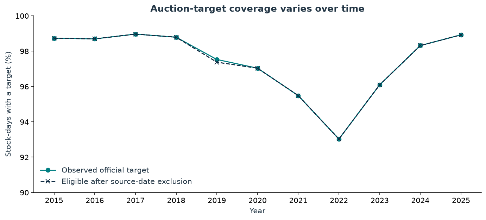
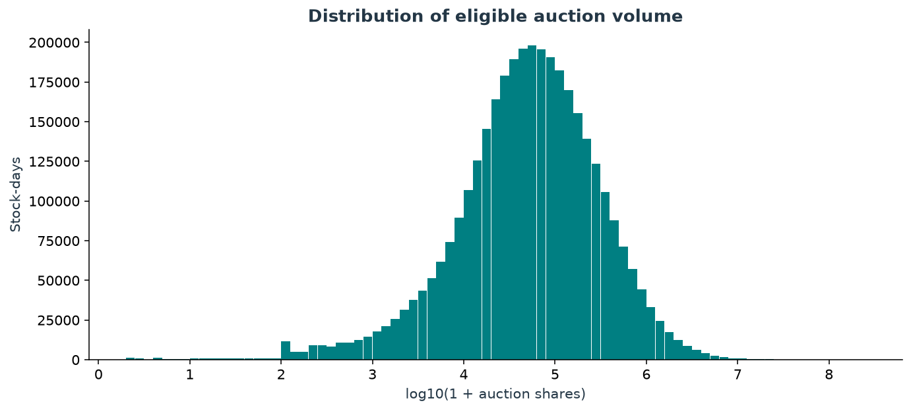
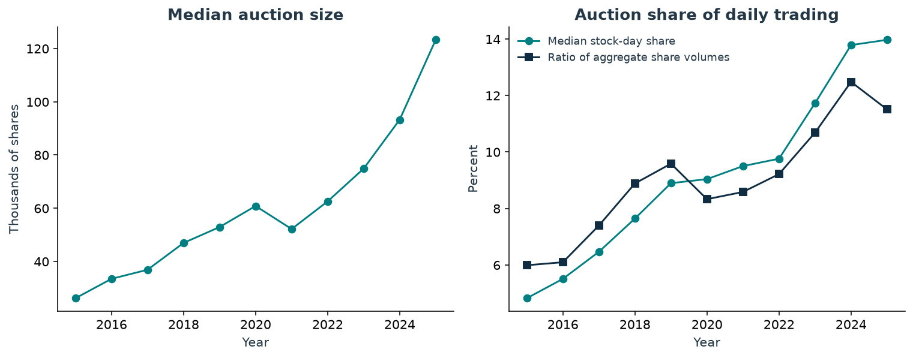
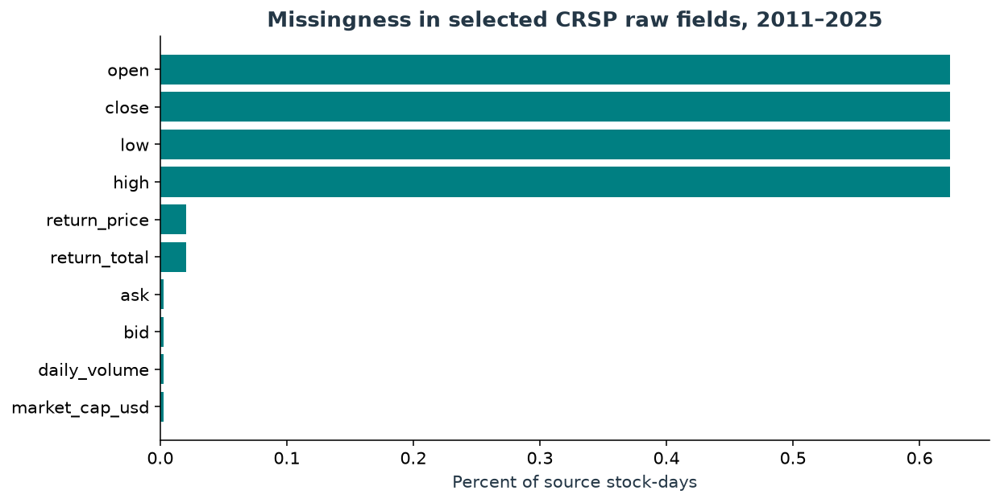
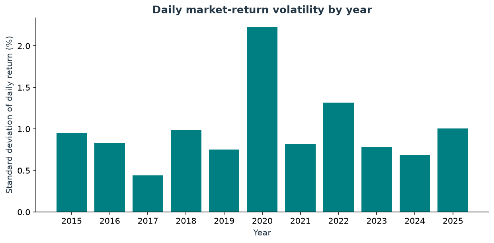
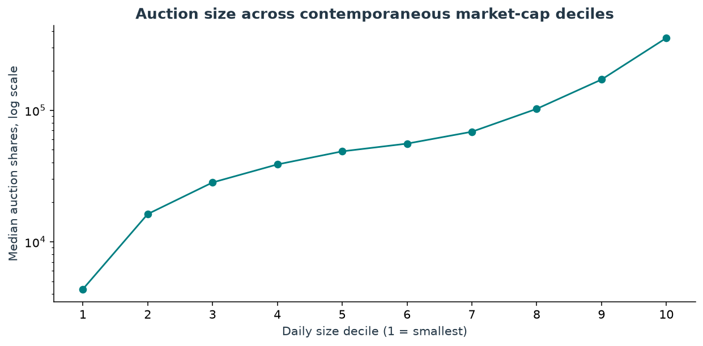
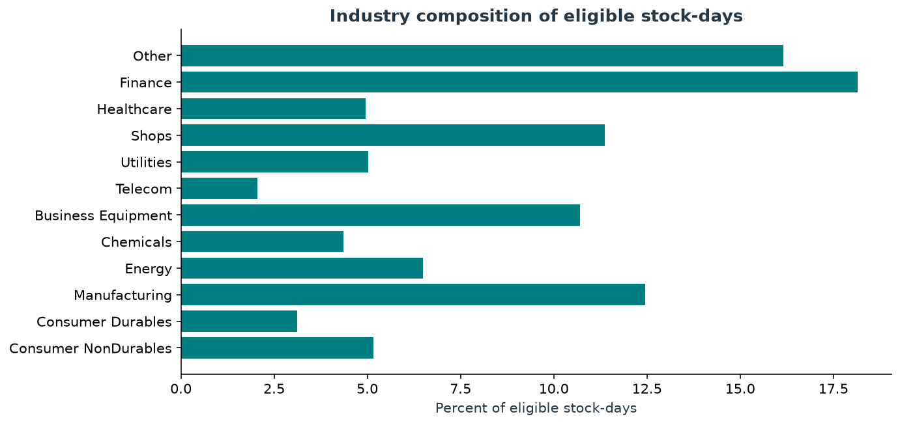
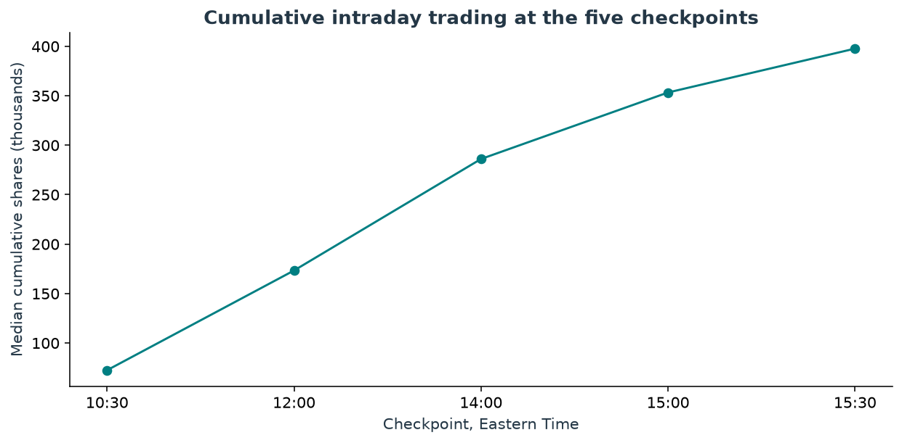

# Raw-data descriptive statistics: midterm scope

## Scope and populations

This report covers source data used through the first 13 research notebooks. A small selection of these results now appears in the presentation. Options-market data and FOMC-specific data are excluded. Monthly and quarterly options-expiry calendar flags remain included.

“Raw data” here means the local, pre-modeling Parquet extracts and supplied context tables. The repository does not contain the original exchange tick feed used to create the extracts. Market and sector tables are already aggregated context inputs. No raw source files or research notebooks were changed.

All source rows are profiled without imputation, winsorization, sampling, or replacing missing targets with zero. Full-history source summaries and the 2015–2025 modeling-period summaries are labeled separately. Daily-market and calendar statistics use trading days. Sector statistics use sector-days. Security statistics use stock-days. Intraday statistics use stock-day-checkpoints. These counts should not be added into one sample size.

The full industry-history reference contains securities and intervals outside the study universe. Its raw inventory is reported separately from industry composition matched to eligible NYSE stock-days. The upstream security master, basic calendar, and symbol bridge are documented separately from the eight directly read inputs.

## Source inventory: eight directly used inputs

| dataset | rows | dates | securities | first_date | last_date | columns | role |
| --- | --- | --- | --- | --- | --- | --- | --- |
| crsp_daily | 4,927,078 | 3,772 | 2,414 | 2011-01-03 | 2025-12-31 | 47 | daily model source |
| auction_daily | 3,594,398 | 2,766 | 2,149 | 2015-01-02 | 2025-12-31 | 80 | target and historical predictors |
| trade_checkpoints | 17,971,990 | 2,766 | 2,149 | 2015-01-02 | 2025-12-31 | 14 | audited data, not a daily-model input |
| market_daily | 3,772 | 3,772 | — | 2011-01-03 | 2025-12-31 | 20 | daily model source |
| sector_daily | 45,264 | 3,772 | — | 2011-01-03 | 2025-12-31 | 16 | daily model source |
| event_calendar | 3,772 | 3,772 | — | 2011-01-03 | 2025-12-31 | 46 | daily model source |
| industry_history | 70,963 | — | 18,497 | 1969-12-19 | 2025-12-31 | 9 | daily model classification source |
| source_anomalies | 1 | 1.0000 | — | 2019-08-12 | 2019-08-12 | 4 | eligibility control |

## Upstream reference inventory

| dataset | rows | dates | securities | first_date | last_date | role |
| --- | --- | --- | --- | --- | --- | --- |
| security_master | 4,927,078 | 3,772 | 2,414 | 2011-01-03 | 2025-12-31 | upstream reference, not directly loaded by stages 01–13 |
| trading_calendar | 3,772 | 3,772 | — | 2011-01-03 | 2025-12-31 | upstream reference, not directly loaded by stages 01–13 |
| taq_crsp_bridge | 4,926,979 | 3,772 | 2,414 | 2011-01-03 | 2025-12-31 | upstream reference, already embedded in TAQ extracts |

## Target coverage and eligibility

The 2015–2025 CRSP universe has 3,594,404 stock-days. Of these, 3,499,885 have an observed official auction label (97.37%). Excluding the documented source anomaly leaves 3,499,401 eligible labels (97.36%).

The weakest observed-label coverage is 2022 at 93.02%. The anomaly exclusion affects 1,261 stock-days on August 12, 2019, of which 484 had an observed label. The 2019 eligible coverage therefore differs from observed-label coverage.

The CRSP universe has 6 more 2015–2025 stock-days than the auction extract. Those unmatched records remain missing targets. Coverage is measured relative to the CRSP universe, not just rows present in the auction file.

| year | stock_days | observed_labels | eligible_labels | excluded_anomaly_stock_days | unobserved_labels | observed_coverage_pct | eligible_coverage_pct |
| --- | --- | --- | --- | --- | --- | --- | --- |
| 2,015 | 341,909 | 337,566 | 337,566 | 0 | 4,343 | 98.7298 | 98.7298 |
| 2,016 | 329,950 | 325,638 | 325,638 | 0 | 4,312 | 98.6931 | 98.6931 |
| 2,017 | 321,370 | 318,040 | 318,040 | 0 | 3,330 | 98.9638 | 98.9638 |
| 2,018 | 317,656 | 313,807 | 313,807 | 0 | 3,849 | 98.7883 | 98.7883 |
| 2,019 | 316,550 | 308,724 | 308,240 | 1,261 | 7,826 | 97.5277 | 97.3748 |
| 2,020 | 312,434 | 303,168 | 303,168 | 0 | 9,266 | 97.0343 | 97.0343 |
| 2,021 | 336,769 | 321,564 | 321,564 | 0 | 15,205 | 95.4850 | 95.4850 |
| 2,022 | 353,277 | 328,634 | 328,634 | 0 | 24,643 | 93.0245 | 93.0245 |
| 2,023 | 331,648 | 318,679 | 318,679 | 0 | 12,969 | 96.0895 | 96.0895 |
| 2,024 | 321,631 | 316,212 | 316,212 | 0 | 5,419 | 98.3151 | 98.3151 |
| 2,025 | 311,210 | 307,853 | 307,853 | 0 | 3,357 | 98.9213 | 98.9213 |

## Auction outcomes: eligible stock-days

Eligible auction volume has a mean of 190,445 shares, median of 55,226, standard deviation of 687,162, and 99th percentile of 2,075,293. The mean is 3.45 times the median. Large auctions materially influence averages.

These statistics use exact quantiles of the eligible population. The distribution chart counts every eligible observation in fixed log-volume bins. A log axis helps display the skew, without changing the raw share-volume target. Auction price and same-day auction/daily-volume share are outcomes or descriptive measures, not daily predictors.

| variable | unit | finite_rows | mean | std_dev | minimum | p25 | median | p75 | p95 | p99 | maximum |
| --- | --- | --- | --- | --- | --- | --- | --- | --- | --- | --- | --- |
| auction_volume | shares | 3,499,401 | 190,445.17 | 687,161.71 | 1.0000 | 18,110 | 55,226 | 163,418 | 732,909 | 2,075,293 | 205,378,788 |
| auction_price | USD per share | 3,499,401 | 362.0733 | 11,743.66 | 0.0890 | 16.7000 | 38.0600 | 77.6500 | 227.2500 | 548.9900 | 806,684 |
| auction_share_daily_volume | fraction or ratio, native scale | 3,498,815 | 0.1062 | 0.0810 | 2.52895e-07 | 0.0497 | 0.0891 | 0.1420 | 0.2517 | 0.3980 | 1.0000 |

## Changes in auction size and share

The median auction rises from 26,180 shares in 2015 to 123,273 in 2025. The median stock-day auction share rises from 4.82% to 13.97%. These are descriptive comparisons in a changing sample, not a fixed-stock or causal trend estimate.

The aggregate-share series is sum(auction shares) / sum(CRSP daily shares) on eligible stock-days. It gives more weight to high-volume stocks and differs from the median stock-day share. It describes this extracted universe, not the whole NYSE. Annual sums are observed-sample totals and do not compensate for missing labels.

| year | eligible_stock_days | securities | median_auction | mean_auction | p99_auction | median_auction_share | volume_weighted_auction_share |
| --- | --- | --- | --- | --- | --- | --- | --- |
| 2,015 | 337,566 | 1,426 | 26,179.50 | 111,053.82 | 1,369,495.45 | 0.0482 | 0.0599 |
| 2,016 | 325,638 | 1,385 | 33,463 | 123,945.79 | 1,443,888.97 | 0.0551 | 0.0610 |
| 2,017 | 318,040 | 1,346 | 36,875 | 132,269.26 | 1,462,775.44 | 0.0647 | 0.0739 |
| 2,018 | 313,807 | 1,327 | 46,948 | 171,288.65 | 1,889,484.34 | 0.0764 | 0.0888 |
| 2,019 | 308,240 | 1,312 | 52,923 | 181,318.11 | 1,986,533.14 | 0.0889 | 0.0958 |
| 2,020 | 303,168 | 1,319 | 60,827.50 | 214,347.24 | 2,456,068.18 | 0.0904 | 0.0833 |
| 2,021 | 321,564 | 1,472 | 52,176.50 | 180,607.51 | 2,036,366.84 | 0.0950 | 0.0858 |
| 2,022 | 328,634 | 1,467 | 62,564.50 | 194,610.62 | 2,111,738.76 | 0.0976 | 0.0921 |
| 2,023 | 318,679 | 1,392 | 74,877 | 220,300.66 | 2,237,211.52 | 0.1173 | 0.1068 |
| 2,024 | 316,212 | 1,328 | 93,278.50 | 259,285.55 | 2,541,194.06 | 0.1378 | 0.1248 |
| 2,025 | 307,853 | 1,303 | 123,273 | 317,282.65 | 2,895,444.04 | 0.1397 | 0.1150 |

## CRSP raw stock characteristics, 2015–2025

Price, daily share volume, dollar volume, market capitalization, returns, and shares outstanding are summarized on all source stock-days in the modeling period, including stock-days lacking an auction target. Returns are decimal daily returns. Shares outstanding are stored in thousands. Market capitalization is in USD.

Pooled price and market-cap means can be much larger than medians. A high price is not automatically an error. The all-field profile retains raw ranges and missingness so unusual values can be investigated without silently deleting them.

| variable | unit | finite_rows | mean | std_dev | minimum | p25 | median | p75 | p99 | maximum | missing_or_nonfinite_pct |
| --- | --- | --- | --- | --- | --- | --- | --- | --- | --- | --- | --- |
| close | USD per share | 3,568,132 | 379.6987 | 12,016.18 | 0.0890 | 15.9800 | 37.3600 | 76.9500 | 552.1600 | 809,350 | 0.7309 |
| daily_volume | shares | 3,594,379 | 2,049,418.32 | 6,121,389.61 | 0 | 212,637 | 637,556 | 1,787,339.50 | 22,272,753.54 | 1,253,254,000 | 0.000695526 |
| daily_price_volume | USD | 3,594,379 | 103,673,962.82 | 274,973,185.13 | 0 | 5,441,121.60 | 24,890,047.20 | 94,066,690.75 | 1,170,825,260.17 | 47,942,227,185.80 | 0.000695526 |
| market_cap_usd | USD | 3,594,379 | 15,552,367,336.02 | 44,835,193,571.55 | 1,875,810 | 851,764,750 | 2,971,385,980 | 10,078,511,450 | 233,969,490,776.00 | 1,049,319,516,960 | 0.000695526 |
| return_total | decimal return (dispersion is standard deviation) | 3,593,756 | 0.000473945 | 0.0325 | -0.8824 | -0.0112 | 0.000141 | 0.0117 | 0.0893 | 6.9446 | 0.0180 |
| shares_outstanding_thousands | shares thousands | 3,594,404 | 228,931.56 | 585,808.64 | 207.0000 | 37,776 | 78,798 | 186,725 | 2,684,000 | 10,550,000 | 0 |

## CRSP missingness

The chart uses the complete 2011–2025 source history. Tables also provide per-field missingness by year. Missingness in historical lags and rolling model features is a separate feature-engineering issue and is outside this raw-data report.

## Market and sector context

Market statistics use one observation per trading day. Sector statistics use one observation per industry and trading day. They are not repeated once per stock. The full inputs contain 3,772 market days and 45,264 sector-days. The 2015–2025 subset contains 2,766 market days.

The market-return chart shows the within-year standard deviation of daily returns, not an annualized return or a causal volatility effect. Supplied market/sector aggregates describe their construction universe; no external all-market coverage claim is made.

| variable | unit | finite_rows | mean | std_dev | p25 | median | p75 | p99 |
| --- | --- | --- | --- | --- | --- | --- | --- | --- |
| market_return_vw | decimal return (dispersion is standard deviation) | 2,766 | 0.000705825 | 0.0108 | -0.0035 | 0.000867795 | 0.0057 | 0.0255 |
| market_total_volume | shares | 2,766 | 2,663,190,956.10 | 672,608,919.80 | 2,252,281,668.50 | 2,515,492,389.50 | 2,907,822,053.50 | 5,286,772,774.30 |
| market_total_cap_usd | USD | 2,766 | 20,210,087,690,842.19 | 4,541,798,289,988.81 | 16,304,500,176,912.50 | 18,416,472,092,605 | 23,667,099,188,202.50 | 29,931,058,835,850.00 |

## Sector summaries, 2015–2025

| ff12_code | ff12_name | sector_days | median_stocks | mean_daily_return | sd_daily_return | median_daily_shares | median_cap_usd |
| --- | --- | --- | --- | --- | --- | --- | --- |
| 1 | Consumer NonDurables | 2,766 | 69.0000 | 0.00049291 | 0.0095 | 113,928,089 | 1,049,728,856,335 |
| 2 | Consumer Durables | 2,766 | 39.0000 | 0.000595961 | 0.0165 | 90,521,792 | 242,738,836,365 |
| 3 | Manufacturing | 2,766 | 157.0000 | 0.000718876 | 0.0133 | 220,250,363 | 1,609,928,905,460 |
| 4 | Energy | 2,766 | 79.0000 | 0.000610079 | 0.0190 | 275,117,669 | 1,221,487,835,780 |
| 5 | Chemicals | 2,766 | 56.0000 | 0.00043689 | 0.0106 | 80,384,773.50 | 910,750,004,345 |
| 6 | Business Equipment | 2,766 | 137.0000 | 0.000906154 | 0.0135 | 289,970,257 | 2,230,248,525,765 |
| 7 | Telecom | 2,766 | 27.0000 | 0.000372916 | 0.0115 | 96,766,150.50 | 586,578,970,025 |
| 8 | Utilities | 2,766 | 61.0000 | 0.000558318 | 0.0116 | 135,577,739 | 940,208,101,240 |
| 9 | Shops | 2,766 | 146.0000 | 0.000737887 | 0.0104 | 256,252,573 | 2,242,008,673,455 |
| 10 | Healthcare | 2,766 | 63.0000 | 0.000662921 | 0.0103 | 135,917,068.50 | 1,990,052,538,330 |
| 11 | Finance | 2,766 | 221.0000 | 0.000704229 | 0.0136 | 445,381,215 | 4,166,617,985,340 |
| 12 | Other | 2,766 | 211.0000 | 0.000773074 | 0.0126 | 331,679,419 | 1,823,177,926,370 |

## Calendar events, 2015–2025

Event frequencies below count distinct trading dates, not stock-days. Indicators overlap. For example, quarterly expiries are also monthly expiries, so event counts must not be summed as mutually exclusive groups. These flags are known in advance and require no options-market dataset.

The separate calendar_target_descriptives.csv contrasts eligible auction outcomes by each event flag. Those contrasts are pooled associations. They do not control for stock composition, time trends, or overlapping calendar events.

| variable | rows | true_rows | missing_rows | true_pct_dates |
| --- | --- | --- | --- | --- |
| early_close_month_end_window | 2,766 | 16 | 0 | 0.5785 |
| expiry_month_end_window | 2,766 | 1 | 0 | 0.0362 |
| is_early_close | 2,766 | 23 | 0 | 0.8315 |
| is_last_trading_day_month | 2,766 | 132 | 0 | 4.7722 |
| is_last_trading_day_quarter | 2,766 | 44 | 0 | 1.5907 |
| monthly_options_expiry | 2,766 | 132 | 0 | 4.7722 |
| quarterly_options_expiry | 2,766 | 44 | 0 | 1.5907 |

## Stock size and industry composition

Size deciles are formed separately on each date from contemporaneous positive market capitalization, using eligible stock-days. This is a descriptive grouping. The forecasting pipeline uses lagged information for actual model inputs.

Industry composition is matched by PERMNO and effective-date interval. If several records cover the same stock-date, the latest interval start/end is selected, matching the existing pipeline. Industry shares count eligible stock-days, so long-lived securities contribute more observations.

| ff12_code | ff12_name | eligible_stock_days | securities |
| --- | --- | --- | --- |
| 1 | Consumer NonDurables | 180,761 | 127 |
| 2 | Consumer Durables | 108,910 | 74 |
| 3 | Manufacturing | 435,569 | 256 |
| 4 | Energy | 227,453 | 163 |
| 5 | Chemicals | 152,677 | 89 |
| 6 | Business Equipment | 374,370 | 303 |
| 7 | Telecom | 71,853 | 60 |
| 8 | Utilities | 175,820 | 97 |
| 9 | Shops | 397,627 | 281 |
| 10 | Healthcare | 173,545 | 112 |
| 11 | Finance | 635,121 | 555 |
| 12 | Other | 565,695 | 444 |

## Industry composition

## Intraday trade checkpoints

These data were audited in the early research stages, but the daily models through stage 13 do not use same-day checkpoint inputs. The raw table has five rows for each represented stock-date.

There are 29,540 post-close rows at each of the 14:00, 15:00, and 15:30 checkpoints. These are scheduled early-close exclusions, not ordinary data failures. Within-session coverage uses only scheduled-valid checkpoint rows in its denominator. Distribution summaries for usable checkpoints further require checkpoint_data_found=true.

Median cumulative volume rises across checkpoints. The plotted points are medians of checkpoint cross-sections, not the path of one representative stock. Time labels are Eastern Time.

| checkpoint | rows | after_close_rows | valid_observed_rows | within_session_rows | median_cum_volume | median_vwap | median_recent_volume_share | coverage_within_session_pct |
| --- | --- | --- | --- | --- | --- | --- | --- | --- |
| 10:30 | 3,594,398 | 0 | 3,582,408 | 3,594,398 | 72,337 | 37.6271 | 0.4972 | 99.6664 |
| 12:00 | 3,594,398 | 0 | 3,582,408 | 3,594,398 | 173,193 | 37.5308 | 0.1551 | 99.6664 |
| 14:00 | 3,594,398 | 29,540 | 3,552,966 | 3,564,858 | 285,945.50 | 37.4567 | 0.0857 | 99.6664 |
| 15:00 | 3,594,398 | 29,540 | 3,552,966 | 3,564,858 | 353,183.50 | 37.4382 | 0.0847 | 99.6664 |
| 15:30 | 3,594,398 | 29,540 | 3,552,966 | 3,564,858 | 397,552.50 | 37.4262 | 0.0977 | 99.6664 |

## Schema differences and missing data

The union of yearly auction schemas contains 80 fields. 71 of those fields are absent from at least one annual file. Many are auxiliary fields or duplicated CRSP fields, rather than missing auction outcomes.

field_profile.csv separates schema_absent_rows from null_in_present_schema_rows. The former counts rows in files where a column does not exist at all. Schema-absence counts come from each file’s actual schema and row count. Numeric summaries use only finite observations; nonfinite counts are reported separately.

The comprehensive numeric_summary.csv includes every numeric measure except identifiers/category codes. Its quantiles are approximate full-population quantiles, explicitly named *_approx. principal_exact_summary.csv and the selected annual/checkpoint summaries use exact quantiles. No summary uses a convenience sample. Categorical frequencies retain up to 30 levels per field; identifier frequencies are omitted. Exact null counts, types, units, and approximate distinct counts are provided for every field.

| dataset | variable | files_with_field | files_total | schema_absent_rows | null_in_present_schema_rows |
| --- | --- | --- | --- | --- | --- |
| auction_daily | ticker_daily | 6 | 11 | 1,645,338 | 0 |
| auction_daily | tradingsymbol | 6 | 11 | 1,645,338 | 0 |
| auction_daily | cusip_hist | 6 | 11 | 1,645,338 | 0 |
| auction_daily | sym_root | 6 | 11 | 1,645,338 | 0 |
| auction_daily | sym_suffix | 6 | 11 | 1,645,338 | 1,913,356 |
| auction_daily | taq_symbol_full | 6 | 11 | 1,645,338 | 0 |
| auction_daily | match_lvl | 6 | 11 | 1,645,338 | 63,545 |
| auction_daily | exact_symbol_match | 6 | 11 | 1,645,338 | 0 |
| auction_daily | cusip_match | 6 | 11 | 1,645,338 | 0 |
| auction_daily | link_source | 6 | 11 | 1,645,338 | 0 |
| auction_daily | link_quality | 6 | 11 | 1,645,338 | 0 |
| auction_daily | bridge_year | 6 | 11 | 1,645,338 | 0 |
| auction_daily | high_confidence_link | 6 | 11 | 1,645,338 | 0 |
| auction_daily | bridge_symbol_collision | 6 | 11 | 1,645,338 | 0 |
| auction_daily | time_m | 6 | 11 | 1,645,338 | 29,073 |
| auction_daily | time_m_nano | 2 | 11 | 2,930,864 | 347,322 |
| auction_daily | tr_seqnum | 6 | 11 | 1,645,338 | 29,073 |
| auction_daily | tr_id | 2 | 11 | 2,930,864 | 347,322 |
| auction_daily | auction_volume_raw | 6 | 11 | 1,645,338 | 29,017 |
| auction_daily | auction_price_raw | 6 | 11 | 1,645,338 | 29,017 |
| auction_daily | price_diff_abs | 6 | 11 | 1,645,338 | 29,659 |
| auction_daily | price_diff_bps | 6 | 11 | 1,645,338 | 29,659 |
| auction_daily | crsp_zero_volume | 10 | 11 | 321,631 | 0 |
| auction_daily | auction_with_zero_crsp_volume | 10 | 11 | 321,631 | 0 |
| auction_daily | auction_time | 6 | 11 | 1,632,510 | 381,506 |
| auction_daily | auction_tr_seqnum | 6 | 11 | 1,632,510 | 381,506 |
| auction_daily | ticker | 5 | 11 | 1,949,060 | 0 |
| auction_daily | cusip | 5 | 11 | 1,949,060 | 0 |
| auction_daily | price | 5 | 11 | 1,949,060 | 22 |
| auction_daily | price_flag | 5 | 11 | 1,949,060 | 0 |
| auction_daily | open | 5 | 11 | 1,949,060 | 15,908 |
| auction_daily | high | 5 | 11 | 1,949,060 | 15,908 |
| auction_daily | low | 5 | 11 | 1,949,060 | 15,908 |
| auction_daily | bid | 5 | 11 | 1,949,060 | 25 |
| auction_daily | ask | 5 | 11 | 1,949,060 | 25 |
| auction_daily | daily_price_volume | 5 | 11 | 1,949,060 | 22 |
| auction_daily | return_total | 5 | 11 | 1,949,060 | 370 |
| auction_daily | return_price | 5 | 11 | 1,949,060 | 370 |
| auction_daily | market_cap_crsp_thousands | 5 | 11 | 1,949,060 | 22 |
| auction_daily | shares_outstanding_thousands | 5 | 11 | 1,949,060 | 0 |
| auction_daily | ordinary_dividend | 5 | 11 | 1,949,060 | 0 |
| auction_daily | nonordinary_dividend | 5 | 11 | 1,949,060 | 0 |
| auction_daily | daily_price_factor | 5 | 11 | 1,949,060 | 0 |
| auction_daily | distribution_flag | 5 | 11 | 1,949,060 | 0 |
| auction_daily | cum_price_factor | 5 | 11 | 1,949,060 | 0 |
| auction_daily | cum_share_factor | 5 | 11 | 1,949,060 | 0 |
| auction_daily | delisting_day_flag | 5 | 11 | 1,949,060 | 0 |
| auction_daily | primary_exchange | 5 | 11 | 1,949,060 | 0 |
| auction_daily | security_type | 5 | 11 | 1,949,060 | 0 |
| auction_daily | security_subtype | 5 | 11 | 1,949,060 | 0 |
| auction_daily | share_type | 5 | 11 | 1,949,060 | 0 |
| auction_daily | us_incorporated | 5 | 11 | 1,949,060 | 0 |
| auction_daily | issuer_type | 5 | 11 | 1,949,060 | 0 |
| auction_daily | conditional_type | 5 | 11 | 1,949,060 | 0 |
| auction_daily | trading_status | 5 | 11 | 1,949,060 | 0 |
| auction_daily | market_cap_usd | 5 | 11 | 1,949,060 | 22 |
| auction_daily | market_cap_rank | 5 | 11 | 1,949,060 | 22 |
| auction_daily | nyse_stock_count | 5 | 11 | 1,949,060 | 0 |
| auction_daily | market_cap_percentile | 5 | 11 | 1,949,060 | 22 |
| auction_daily | top_100_mcap | 5 | 11 | 1,949,060 | 22 |
| auction_daily | top_500_mcap | 5 | 11 | 1,949,060 | 22 |
| auction_daily | top_1000_mcap | 5 | 11 | 1,949,060 | 22 |
| auction_daily | missing_price | 5 | 11 | 1,949,060 | 0 |
| auction_daily | missing_volume | 5 | 11 | 1,949,060 | 0 |
| auction_daily | zero_volume | 5 | 11 | 1,949,060 | 0 |
| auction_daily | missing_market_cap | 5 | 11 | 1,949,060 | 0 |
| auction_daily | missing_any_ohlc | 5 | 11 | 1,949,060 | 0 |
| auction_daily | year | 5 | 11 | 1,949,060 | 0 |
| auction_daily | auction_gt_positive_crsp_volume | 5 | 11 | 1,949,060 | 0 |
| auction_daily | auction_close_abs_diff | 5 | 11 | 1,949,060 | 65,440 |
| auction_daily | auction_close_diff_bps | 5 | 11 | 1,949,060 | 65,440 |

## Keys, domain checks, and reconciliation

All 11 profiled tables have zero duplicate excess rows for their stated keys. All 10 listed numeric-domain checks return zero flagged rows. This verifies the stated checks, not every possible source-data issue.

Fresh source-row counts reconcile to the existing data inventory. Fresh eligible-label counts reconcile to the saved research sample-eligibility totals. The large engineered model panel is not required for this raw-data report. Source files are read without rewriting them. The run records file sizes and modification times for reproducibility.

| check_name | flagged_rows |
| --- | --- |
| auction volume negative | 0 |
| auction share above one | 0 |
| auction shares above positive CRSP daily volume | 0 |
| auction raw ratio disagrees with volume/daily_volume (>1e-8) | 0 |
| CRSP high below low | 0 |
| CRSP negative daily volume | 0 |
| CRSP total return below -100 percent | 0 |
| checkpoint cumulative volume negative | 0 |
| checkpoint recent volume share above one | 0 |
| checkpoint cumulative volume decreases within stock-day | 0 |

## What these results support

The data support a discussion of high but time-varying target coverage, strongly skewed auction size, variation across size and industry, changing auction participation, and the distinction between daily predictors and intraday information.

Before choosing slides, we should decide which few exhibits best explain the forecasting problem. Selected results now appear in two graph slides and one descriptive-summary slide. The full report remains available for reference. This report does not estimate causal effects, test model accuracy, or select the final descriptive exhibits.

## Complete tables

- [annual_inventory.csv](tables/annual_inventory.csv)
- [annual_target_coverage.csv](tables/annual_target_coverage.csv)
- [auction_by_year.csv](tables/auction_by_year.csv)
- [auction_log_histogram.csv](tables/auction_log_histogram.csv)
- [calendar_target_descriptives.csv](tables/calendar_target_descriptives.csv)
- [categorical_frequencies_top30.csv](tables/categorical_frequencies_top30.csv)
- [checkpoint_summary.csv](tables/checkpoint_summary.csv)
- [contemporaneous_size_deciles.csv](tables/contemporaneous_size_deciles.csv)
- [dataset_inventory.csv](tables/dataset_inventory.csv)
- [domain_checks.csv](tables/domain_checks.csv)
- [field_profile.csv](tables/field_profile.csv)
- [file_inventory.csv](tables/file_inventory.csv)
- [file_schemas.csv](tables/file_schemas.csv)
- [flag_rates_by_year.csv](tables/flag_rates_by_year.csv)
- [industry_eligible_stockdays.csv](tables/industry_eligible_stockdays.csv)
- [key_checks.csv](tables/key_checks.csv)
- [missingness_by_year.csv](tables/missingness_by_year.csv)
- [numeric_summary.csv](tables/numeric_summary.csv)
- [principal_by_year.csv](tables/principal_by_year.csv)
- [principal_exact_summary.csv](tables/principal_exact_summary.csv)
- [reconciliation_checks.csv](tables/reconciliation_checks.csv)
- [sector_native_summary.csv](tables/sector_native_summary.csv)
