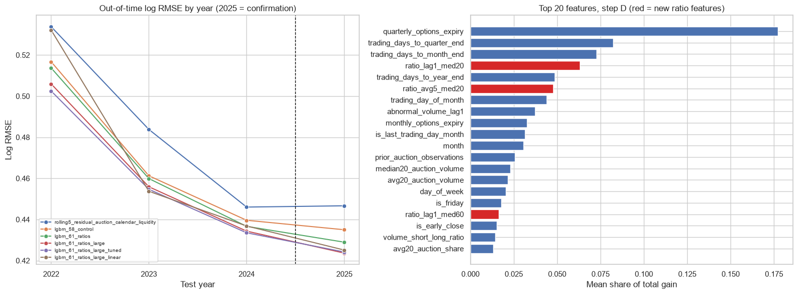
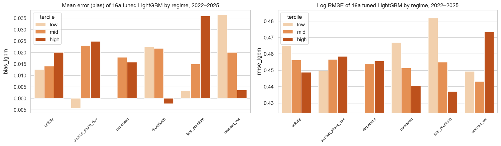
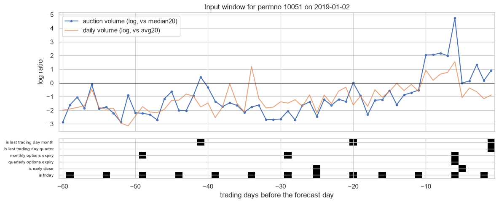
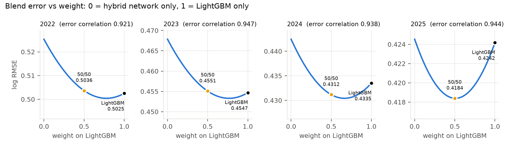
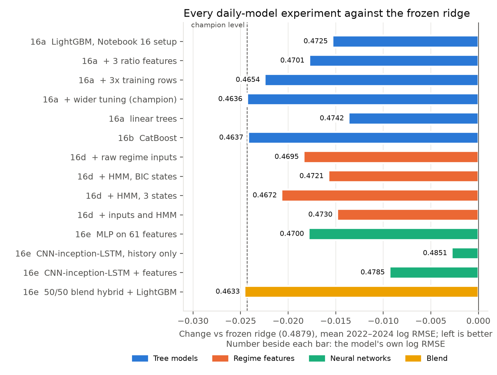

# Daily Model Experiments

Last updated November 16 2026 (Notebooks 16a–16e)

## Executive summary

This is a running report of experiments on the daily closing-auction forecast; new experiments are appended as they finish. It currently covers five, the forecast made with information available by the close of the previous trading day. Each experiment started from an analysis suggesting the idea might help. Each was then tested against the same rolling out-of-time protocol and the same replacement rule. Intraday work is out of scope; ideas for that stage are recorded separately in reports/intraday_model_ideas.md.

The daily champion is now a tuned LightGBM trained on three times more rows with three new ratio features (lgbm_61_ratios_large_tuned):
- **Mean 2022–2024 development log RMSE: 0.4636**, compared with 0.4879 for the frozen ridge benchmark (−0.0243) and 0.4725 for the Notebook 16 LightGBM setup rerun on identical terms (−0.0090).
- **2025 confirmation log RMSE: 0.4242**, compared with 0.4467 for the ridge.
- **Development WAPE: 34.88%**, compared with 36.74% for the ridge.

What worked:
- **Three ratio features** built from data already in the panel (prior-day auction volume over the 20-day median, the 5-day average over the 20-day median, and prior-day volume over the 60-day median).
- **Training on more rows.** This was the largest single gain.
- **A wider hyperparameter search.**
- **CatBoost** matched the champion (0.4637). It is a viable alternative, but not an improvement.

What did not work:
- **Linear trees.**
- **Market-regime features**, from a hidden Markov model or the raw regime inputs. Every variant made the model worse.
- **The CNN + inception + LSTM sequence networks** adapted from an external closing-auction model. None beat the champion.

A fixed 50/50 blend of the hybrid network and the champion reached 0.4633 in development and 0.4184 in 2025. The 2025 gain (−0.0058) is real and fully explained by error diversification, but the development gain (−0.0003) is far below the 0.002 threshold, and two of the three development years got worse. It was not adopted. Section 7 explains the mechanism.

| Experiment | Idea | Best development log RMSE | Change vs prior best | Outcome |
| --- | --- | ---: | ---: | --- |
| 16a | Ratio features, more data, tuning, linear trees | 0.4636 | −0.0090 vs Notebook 16 setup | Adopted |
| 16b | CatBoost | 0.4637 | +0.0001 vs 16a champion | Tie; not adopted |
| 16c | Do market regimes matter? (analysis only) | not a model | hindsight ceiling about 0.001 | Weak case for regime features |
| 16d | HMM regime features for LightGBM | 0.4672 | +0.0018 vs same-row control | Rejected |
| 16e | CNN + inception + LSTM, MLP, blend | 0.4633 (blend) | −0.0003 vs 16a champion | Rejected |

## 1 Shared evaluation protocol

All five experiments reuse the Notebook 16 challenger protocol. Results are therefore comparable across notebooks, and each new idea is judged against an identical control.

| Element | Setting |
| --- | --- |
| Target | Residual: log1p(auction volume) minus log1p(20-day median auction volume), converted back to shares for scoring |
| Information rule | Every feature known by the close of t−1; rolling windows end at the preceding row |
| Folds | For test year t: tune on t−6 to t−2, validate and early-stop on t−1, refit on t−5 to t−1 |
| Years | 2022–2024 development (equal-year average), 2025 confirmation |
| Rows | Base tier 250K tune / 120K validation / 350K refit; large tier 750K / 150K / 1M; test years scored in full |
| Same-row design | Every candidate in a tier uses identical sampled rows, seeds and preprocessing, so differences come only from the change being tested |
| Replacement rule | Mean development log RMSE at least 0.002 better, no development year more than 0.002 worse, and a paired date-block bootstrap of log MAE with its 97.5% bound below zero |

The development and confirmation numbers are log RMSE of log1p shares (lower is better). WAPE is total absolute share error divided by total actual shares. Aggregate bias is total forecast shares divided by actual shares, minus one. The 16a control (0.4725) is the Notebook 16 LightGBM recipe rerun inside this series' helper code. Its sampling and preprocessing pipeline differs slightly from the November 4 reproduction (0.4694), so all comparisons below are made against same-row controls rather than against that earlier figure.

## 2 Experiment 16a: LightGBM improvements

### 2.1 Why we tried it

The starting question was whether the ratio of prior-day closing volume to its 20-day median was being used, and whether it was worth adding.
- **The ratio itself was not a feature.** The panel holds both inputs and a binary spike flag (prior day more than twice the median), but not the ratio.
- **Ridge effectively already had it,** because log(lag1) − log(median20) is a linear combination of two inputs it already sees. Its out-of-sample errors barely correlated with the ratio (Spearman 0.02).
- **Trees did not.** A tree can only approximate a ratio through many splits. LightGBM's errors still correlated with the ratio (0.047, with the same sign in all four years), and it under-predicted after days at 1.3–1.6 times the median.

A quick ablation on fixed settings supported adding a small family of ratios:

| Features (quick test, fixed 31 leaves) | 2022 | 2023 | 2024 | Mean log RMSE |
| --- | ---: | ---: | ---: | ---: |
| Current 58 features | 0.5172 | 0.4735 | 0.4411 | 0.4773 |
| Plus lag1 over median20 only | 0.5148 | 0.4730 | 0.4419 | 0.4765 |
| Plus three ratios | 0.5132 | 0.4679 | 0.4388 | 0.4733 |

The review of the Notebook 16 tree setup also found two cheap opportunities:
- **Training data.** Each five-year window holds about 1.5M eligible rows, but only 350K were used.
- **Tuning.** Only the leaf count was searched.

Linear trees, which fit a small linear model inside each leaf, were added because they suit a target measured relative to a median.

### 2.2 Design

One change was added at a time on identical rows:
- **A:** the Notebook 16 control.
- **B:** plus the three ratios.
- **C:** plus about three times more training rows (the large tier).
- **D:** plus an eight-configuration search over learning rate, leaves, minimum leaf size, row and column sampling and L2 penalty.
- **E:** linear trees on C.

A leakage check rebuilt the ratio inputs from raw files for five stocks using only earlier days. It matched the panel on all 13,830 stock-days.

### 2.3 Results

| Candidate | 2022 | 2023 | 2024 | Development | 2025 | Development WAPE |
| --- | ---: | ---: | ---: | ---: | ---: | ---: |
| Frozen ridge | 0.5338 | 0.4838 | 0.4460 | 0.4879 | 0.4467 | 36.74% |
| A Notebook 16 control | 0.5167 | 0.4613 | 0.4396 | 0.4725 | 0.4350 | 35.54% |
| B plus ratios | 0.5137 | 0.4599 | 0.4367 | 0.4701 | 0.4290 | 35.26% |
| C plus more rows | 0.5060 | 0.4559 | 0.4343 | 0.4654 | 0.4236 | 35.07% |
| D plus wider tuning | 0.5025 | 0.4547 | 0.4335 | 0.4636 | 0.4242 | 34.88% |
| E linear trees | 0.5322 | 0.4537 | 0.4368 | 0.4742 | 0.4251 | 36.34% |

Step effects on mean development log RMSE:
- **Ratios:** −0.0024, improving every year, and −0.0060 in 2025. They pass the replacement rule against the control. LightGBM ranks lag1 over median20 as its fourth most important feature.
- **More rows:** −0.0047, the largest single gain.
- **Wider tuning:** −0.0018, though 2025 is slightly worse (+0.0005). Row bagging was part of the chosen settings.
- **Linear trees:** fail, breaking down in 2022 (+0.026 against C).

D, B and C all pass against the control and against the ridge. D became the champion.

## 3 Experiment 16b: CatBoost

### 3.1 Why we tried it

No XGBoost, CatBoost, random forest or extra-trees model had been tested. CatBoost was the most promising of these:
- It builds symmetric trees.
- It uses ordered boosting, which is designed to reduce overfitting.
- It is usually less sensitive to tuning.

These differences made it the strongest candidate both to beat LightGBM and to make different errors for a later ensemble.

### 3.2 Design and results

CatBoost used exactly the same rows and 61 features as LightGBM C and D, a learning rate of 0.08, and a four-configuration search (depth 6 or 8, L2 penalty 3 or 10). Depth 8 won in every year.

| Model | 2022 | 2023 | 2024 | Development | 2025 | Development WAPE |
| --- | ---: | ---: | ---: | ---: | ---: | ---: |
| LightGBM D (champion) | 0.5025 | 0.4547 | 0.4335 | 0.4636 | 0.4242 | 34.88% |
| CatBoost | 0.5041 | 0.4563 | 0.4306 | 0.4637 | 0.4229 | 35.11% |

- **CatBoost ties the champion.** It is better in 2024 and 2025, and LightGBM is better in 2022 and on WAPE.
- **It passes against the ridge and the Notebook 16 control,** but not against LightGBM C or D.
- **It needed less effort:** a four-configuration search, and about four times faster than 16a's search.
- **Its errors are 0.985 correlated with LightGBM's.** A quick, informal average of the two gave about 0.462 in development, so ensembling two boosters offers little.

## 4 Notebook 16c: do market regimes matter?

### 4.1 Why we looked

The next idea was to use a hidden Markov model (HMM) to find hidden market regimes, with BIC to choose the number of states, and feed them to the model. Before building it, we checked whether the champion's errors left room for a regime signal:
- **Part of the error is market-wide.** About 9% of the champion's error variance moves all stocks together on the same day.
- **That market-wide error does not persist.** Its correlation from one day to the next is 0.02, and 0.07 on regular non-event days.
- **A persistence-based adjustment made things worse.** Subtracting the previous 20 days' average market-wide error raised log RMSE from 0.4539 to 0.4545.

A regime feature could therefore only help if regimes change how other features relate to volume.

The HMM inputs were designed to describe slow, persistent market conditions, use only data up to t−1, and exclude event days from their rolling baselines:
- **Activity:** market volume against its 60-day median.
- **Realized volatility.**
- **Auction-share deviation:** market-wide auction share against its trailing one-year level.
- **Return dispersion.**
- **Fear premium:** implied over realized volatility.
- **Drawdown:** the market's drop from its one-year high.

Raw price and VWAP levels were rejected because they trend for years. A market-wide close-versus-VWAP gap was tested and dropped:
- It barely differed between event and regular days (49 vs 47 basis points).
- It mainly tracked volatility.
- Its correlation with the champion's next-day error was 0.02.

### 4.2 Findings

| Question | Finding | Supports regime features? |
| --- | --- | --- |
| Are conditions persistent? | Yes: inputs stay in a tercile for 5–23 days, but the model's market-wide error has no persistence (0.02) | Partly |
| Are there distinct states? | A Gaussian mixture's BIC drops sharply from 1 to 3 components, then flattens | Yes, about 3 |
| Does volume differ by regime? | Modestly: level gaps of 0.04–0.08 log, and the spike effect varies by about ±12% | Yes |
| Do relationships move with regimes? | Mostly a decade-long trend; once detrended, the strongest link flips sign | Weak |
| Is there room left in the champion? | Error spread differs by regime (log RMSE 0.44–0.48), but removing each regime's bias with hindsight gains at most 0.0011 | No: below the 0.002 rule |
| Are the inputs usable? | Fear premium is −0.92 correlated with volatility; dispersion drifted out of its training range | Two inputs dropped |

The analysis made a weak case for regime features in the point forecast. Regimes looked more useful for widening or narrowing prediction intervals. The project's objective is point accuracy (RMSE), so intervals were set aside and the regime features were tested directly.

## 5 Experiment 16d: HMM regime features

### 5.1 Design

The HMM was designed so that no test or validation data could influence it:
- **Inputs:** four market-wide inputs (activity, realized volatility, auction-share deviation and drawdown), each known by t−1.
- **Fitting:** a Gaussian HMM with full covariances, fitted inside each training window only. Each fold has a separate tuning-phase and refit-phase fit, standardized with that window's statistics and given 10 random restarts.
- **States:** chosen by BIC over 1–6 states, with a fixed 3-state model as a check.
- **No look-ahead:** features use forward-filtered probabilities only. Deleting later data changed earlier features by about 3e−12.
- **Features:** nine, the same whatever the state count. They are the probabilities of the calmest and most stressed states, the most likely state's rank, the uncertainty (entropy), the days since the regime changed, and the expected value of each input.

Five LightGBM models were trained on the large-tier rows. The control reproduced 16a's lgbm_61_ratios_large exactly in every year.

### 5.2 Results

| Candidate | Development | Change vs control | 2025 change | Passes |
| --- | ---: | ---: | ---: | --- |
| Control (= 16a C) | 0.4654 | — | — | — |
| Plus raw regime inputs | 0.4695 | +0.0041 | +0.0123 | No |
| Plus HMM, BIC states | 0.4721 | +0.0067 | +0.0096 | No |
| Plus HMM, 3 states | 0.4672 | +0.0018 | +0.0131 | No |
| Plus inputs and HMM | 0.4730 | +0.0076 | +0.0105 | No |

Every variant was worse in development and in 2025:
- **The trees overfit to the regime features.** Regime features took 6–13% of total split gain, yet out-of-time error rose. A regime feature has one value per day, shared by about 1,300 stocks, so the trees used it to recognize particular training periods and learn their residual levels. Those levels do not repeat in a new year.
- **BIC was unreliable.** It chose the maximum of six states in all eight fits, the expected bias from smoothed, autocorrelated inputs. The six-state solutions also shifted between the tuning and refit fits.
- **The 3-state model was the least harmful,** but it was still worse than the control.
- **This matches 16c's hindsight ceiling of about 0.001.**

Regime features were rejected.

## 6 Experiment 16e: CNN + inception + LSTM sequence networks

### 6.1 Why we tried it

An external closing-auction research model combines three parts:
- stacked 1D convolutions that act as learnable smoothing filters while keeping the time resolution
- inception modules with several kernel sizes, to learn patterns at multiple time scales
- an LSTM to carry memory of earlier states and of the order flow before the auction

There were three reasons to test it here:
- **No neural network had been tried.**
- **A network can learn its own filters** from a stock's raw history instead of relying on hand-built lags, averages and medians.
- **Networks usually make errors less correlated with tree errors** than another booster does. CatBoost's 0.985 correlation had shown that boosters overlap almost completely.

The original reads intraday order flow, which a daily forecast cannot see. It was adapted to daily data, and the intraday version was recorded for later.

### 6.2 Design

**Input sequence.** For each stock-day, the stock's previous 60 trading days, with 13 values per day:
- auction and daily volume, in logs relative to the 20-day levels known at t−1
- auction share
- return and absolute return
- six past event flags, so a month-end spike is not mistaken for a surprise
- a missing-auction flag and a row-present flag

**No look-ahead.** Windows use only strictly earlier rows of the same stock. The last window day reproduced lag1_auction_volume, and the median of the last 20 window days reproduced median20_auction_volume, in 100% of checked rows.

**Network.** Two 1D convolutions (13 to 32 to 64 channels, same length), then an inception block (kernels 3, 7 and 15 plus a pooling branch, 96 channels), then an LSTM with 64 hidden units. About 98K parameters.

**Training.** Identical rows to the large tier, the same residual target, MSE loss and AdamW (learning rate 0.001):
- Up to eight epochs, with early stopping on the validation year (patience two).
- A refit for the chosen number of epochs, mirroring how LightGBM picks its iteration count.
- One fixed configuration and no hyperparameter search, trained on the laptop's GPU (MPS) in about 1h50m.

**Candidates.**
- A plain MLP on the 61 features.
- The sequence network with only the target day's calendar, closest to the original.
- A hybrid of the sequence and the 61 features.
- A fixed 50/50 blend in log space of the hybrid and the champion. The weight was set in advance, not tuned.

### 6.3 Results

| Candidate | 2022 | 2023 | 2024 | Development | 2025 | Development WAPE | Error correlation with champion |
| --- | ---: | ---: | ---: | ---: | ---: | ---: | ---: |
| 16a champion | 0.5025 | 0.4547 | 0.4335 | 0.4636 | 0.4242 | 34.88% | 1.00 |
| MLP on 61 features | 0.5050 | 0.4624 | 0.4427 | 0.4700 | 0.4249 | 35.72% | 0.96 |
| Sequence only | 0.5417 | 0.4703 | 0.4433 | 0.4851 | 0.4277 | 36.95% | 0.91 |
| Hybrid | 0.5253 | 0.4678 | 0.4424 | 0.4785 | 0.4245 | 35.78% | 0.93 |
| 50/50 blend | 0.5036 | 0.4551 | 0.4312 | 0.4633 | 0.4184 | 34.85% | — |

**The sequence-only network learns a lot from raw history.** Without any hand-built feature it reaches 0.4851, slightly better than the frozen ridge (0.4879). But it is 0.022 behind the champion: the rolling features already capture the useful shape of daily history.

**The sequence branch overfits.** The hybrid is worse than the plain MLP on the same 61 features. Training error kept falling while validation error bottomed out after one to five epochs and swung by about ±0.005 between epochs.

**By segment:**
- The networks are weakest on quarterly-expiry and month-end days.
- The MLP is slightly better than the champion on the top 1% of volumes (1.096 vs 1.109 log RMSE).

**No network passes against the champion.**

## 7 Why the 50/50 blend has a lower RMSE than LightGBM

The blend averages the two forecasts in log space, so its error on every row is the average of the two models' errors: e_blend = ½ e_LightGBM + ½ e_network. Squaring and averaging gives an exact identity:

MSE_blend = ¼ σ_L² + ¼ σ_N² + ½ ρ σ_L σ_N

Here σ_L and σ_N are the two models' RMSEs, and ρ is the correlation of their errors measured about zero. This formula reproduces the actual blend RMSE to five decimals in every year. The blend's gain is therefore entirely error diversification; nothing else is involved.

**When does the blend win?** Setting MSE_blend below σ_L² shows that the 50/50 blend beats LightGBM exactly when the error correlation is below a break-even value: ρ < (3σ_L² − σ_N²) / (2σ_L σ_N). The more accurate the network is relative to LightGBM, the higher that break-even and the easier it is to clear.

| Year | LightGBM | Hybrid network | Error correlation | Break-even for 50/50 | 50/50 blend | Blend minus LightGBM |
| --- | ---: | ---: | ---: | ---: | ---: | ---: |
| 2022 | 0.5025 | 0.5253 | 0.921 | 0.912 | 0.5036 | +0.0011 |
| 2023 | 0.4547 | 0.4678 | 0.947 | 0.943 | 0.4551 | +0.0004 |
| 2024 | 0.4335 | 0.4424 | 0.938 | 0.959 | 0.4312 | −0.0024 |
| 2025 | 0.4242 | 0.4245 | 0.944 | 0.998 | 0.4184 | −0.0058 |

Source: data/blend_decomposition.csv, computed from the 16e predictions.

**What the table shows:**
- **2022 and 2023:** the network was clearly weaker. The break-even fell below the actual correlation, and the equal weight gave too much influence to the weaker model, so the blend lost slightly.
- **2024:** the network was close enough for diversification to win.
- **2025:** the network was almost exactly as accurate as LightGBM (0.4245 vs 0.4242). The break-even was nearly 1, so any imperfect correlation produces a gain. With ρ = 0.944, the blend cut log RMSE by 0.0058.
- **Why the errors cancel:** the two models give errors of opposite sign on about 11% of rows, and the gap between their forecasts has a standard deviation of about 0.17 log points. Averaging pulls those rows toward the truth.

**What the blend does not do:**
- **It does not fix bias.** Its aggregate share bias in development (−16.5%) is deeper than LightGBM's (−15.2%), because the hybrid under-predicts more. The gain is purely in the spread of errors.
- **Its development gain is too small.** Averaged equally over the three development years, the blend is only 0.0003 better than LightGBM. Two of the three years are worse, so it fails both the 0.002 improvement rule and the paired test.

**The best possible weight is not a valid result.** Choosing the weight with hindsight, about 74% LightGBM in development, would reach roughly 0.4629 pooled, about 0.002 better than LightGBM. But it was chosen using test-year data. A valid version must choose the weight on the validation year inside each fold.

## 8 All experiments compared

| Model | Development | 2025 | vs ridge | vs champion | Development WAPE | Development bias |
| --- | ---: | ---: | ---: | ---: | ---: | ---: |
| Frozen ridge | 0.4879 | 0.4467 | — | +0.0243 | 36.74% | −14.5% |
| 16a Notebook 16 control | 0.4725 | 0.4350 | −0.0153 | +0.0090 | 35.54% | −17.4% |
| 16a plus ratios | 0.4701 | 0.4290 | −0.0178 | +0.0065 | 35.26% | −17.0% |
| 16a plus more rows | 0.4654 | 0.4236 | −0.0225 | +0.0018 | 35.07% | −14.7% |
| 16a champion, tuned | 0.4636 | 0.4242 | −0.0243 | — | 34.88% | −15.2% |
| 16a linear trees | 0.4742 | 0.4251 | −0.0136 | +0.0107 | 36.34% | −11.6% |
| 16b CatBoost | 0.4637 | 0.4229 | −0.0242 | +0.0001 | 35.11% | −14.5% |
| 16d plus HMM, 3 states | 0.4672 | 0.4367 | −0.0207 | +0.0036 | 35.24% | −15.1% |
| 16d plus raw regime inputs | 0.4695 | 0.4359 | −0.0184 | +0.0059 | 35.39% | −15.2% |
| 16e MLP | 0.4700 | 0.4249 | −0.0178 | +0.0065 | 35.72% | −12.6% |
| 16e hybrid network | 0.4785 | 0.4245 | −0.0093 | +0.0150 | 35.78% | −16.9% |
| 16e sequence-only network | 0.4851 | 0.4277 | −0.0028 | +0.0215 | 36.95% | −11.1% |
| 16e 50/50 blend | 0.4633 | 0.4184 | −0.0246 | −0.0003 | 34.85% | −16.5% |

Source: data/all_models_summary.csv and each notebook's candidate_metrics.csv. Development values are equal-year 2022–2024 averages. Bias is total forecast shares divided by actual shares, minus one.

## 9 Conclusions and next steps

**The champion is lgbm_61_ratios_large_tuned.** It improves the frozen ridge by 0.0243 log RMSE and the Notebook 16 LightGBM setup by 0.0090. Both margins hold in 2025.

Lessons from the series:
- **Inputs and data mattered more than model class.** The clear gains came from inputs that trees cannot easily build themselves (ratios) and from more training data. A different booster, a different architecture and market-regime information did not add accuracy.
- **Date-level features overfit tree models.** Features shared by every stock on a day, such as regimes, let the model memorize periods. Market-wide information already reaches the model through stock-level lags.
- **There is real diversity between neural networks and trees** (error correlation 0.91–0.96 compared with 0.985 between boosters). The networks are just not accurate enough on daily data for a fixed blend to clear the rule.

Possible next steps for the daily model, none started:
- **A per-stock bias feature.** Parked earlier, it targets a different error source: stocks that are persistently over- or under-forecast.
- **A blend with its weight chosen on the validation year,** using several network seeds or the MLP, which was the strongest network and is cheap to train.
- **A stock-level previous-day close-versus-VWAP gap** as a tree feature. Only the market-wide version was tested.
- **Regime-aware prediction intervals,** only if interval coverage becomes a project requirement. They would not change RMSE.

## Appendix A Artifacts

All paths are relative to the repository root. Notebooks run from a separate workspace so that repository outputs only change when results are deliberately copied in. Row-level prediction files are git-ignored and rebuilt by rerunning the notebooks.

| Notebook | Builder and helpers | Outputs |
| --- | --- | --- |
| 16a_lightgbm_improvements.ipynb | build_notebook_16a.py, challenger_utils.py | outputs/eda/16a_lightgbm_improvements |
| 16b_catboost_challenger.ipynb | build_notebook_16b.py, challenger_utils.py | outputs/eda/16b_catboost_challenger |
| 16c_regime_motivation.ipynb | build_notebook_16c.py, regime_utils.py | outputs/eda/16c_regime_motivation |
| 16d_hmm_regime_features.ipynb | build_notebook_16d.py, regime_utils.py, challenger_utils.py | outputs/eda/16d_hmm_regime_features |
| 16e_sequence_neural_networks.ipynb | build_notebook_16e.py, sequence_utils.py, challenger_utils.py | outputs/eda/16e_sequence_neural_networks |

This report's folder contains analyse_blend.py (Section 7 numbers), make_figures.py (Figures 1 and 2), the data folder with their CSVs, and build_report.py, which creates the Word version from this text.
